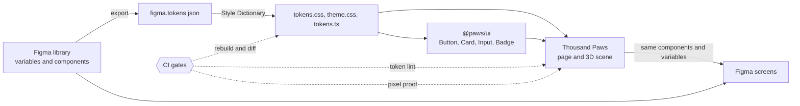

# Thousand Paws

A small 3D arcade game built with React, Vite and Three.js. A counter races upward, speeding up and slowing down at random. Press the big red button when it reads exactly 1000 and one of the eight teddy bears on the shelf beside you unlocks.

**[Play it](https://thousand-paws.vercel.app)**

It is also a working example of an automated loop between Figma and code: every colour, radius and type size comes from a [Figma library](https://www.figma.com/design/FTrMG6oKwU8Arzt3QEru59/) through [pawprint-tokens](https://github.com/aminchegini/pawprint-tokens), and CI rejects anything that drifts.



## What the pipeline has proved

Each row links to the pull request or run where it happened.

| Claim | Evidence |
|---|---|
| A live app moved onto tokens | [#3](https://github.com/aminchegini/thousand-paws/pull/3): 0% to 100% token parity, 117 stray colour references gone |
| One component set in code and Figma | [#8](https://github.com/aminchegini/thousand-paws/pull/8): the side panel uses the same Button, Card and Badge as the library |
| A rename across Figma and code moves no pixels | [#6](https://github.com/aminchegini/thousand-paws/pull/6): CI measured 0 of 4,096,000 pixels changed across the four finishes |
| Unused aliases can be retired safely | [pawprint-tokens #2](https://github.com/aminchegini/pawprint-tokens/pull/2): removed once the usage counter read zero |
| A hard-coded colour is rejected | [#7](https://github.com/aminchegini/thousand-paws/pull/7), closed on purpose: Token lint failed, even though the hex matched the token |
| A hand-edited token is rejected | [pawprint-tokens #4](https://github.com/aminchegini/pawprint-tokens/pull/4), closed on purpose: Token drift failed |

Current token parity is in [`metrics/token-parity.json`](metrics/token-parity.json).

The four cabinet finishes are the modes of the library's Semantic variable collection. Pick one in the game, or switch the mode on a frame in the [screens file](https://www.figma.com/design/DMkH0TywNmT0iRp2PnhWOn/), and the same tokens drive both.

## Licence

[MIT](LICENSE). Use it for anything, including commercial projects, as long as you keep the copyright and licence notice. The token pipeline it is paired with, [pawprint-tokens](https://github.com/aminchegini/pawprint-tokens), is MIT licensed too.

## Run it

You need Node 22 or newer and pnpm 10.

```bash
pnpm install
```

```bash
pnpm dev
```

That starts the game on http://localhost:5183.

Tests and production builds:

```bash
pnpm test
```

```bash
pnpm build
```

## How it plays

- Press the red button on the cabinet, the Start button in the side panel, or Space. The counter starts at 0.
- Its speed changes every 0.3 to 1.2 seconds: crawl, medium or sprint. From 985 on it only uses slow speeds.
- Press again to stop it. You win only if the number on screen is exactly 1000. A miss tells you how far off you were.
- The counter never skips 1000. It stays on screen for a guaranteed minimum time, which shrinks from 120 ms to 50 ms as your shelf fills up.
- If nobody stops it, the round ends as a miss at 1050.
- Each win unlocks one random bear. The gold bear, The Grand, comes last.
- Progress is saved in your browser. There is no account and no server.

Every number above is a constant in [`apps/thousand-paws/src/game/spec.js`](apps/thousand-paws/src/game/spec.js).

## Layout

| Path | What it is |
|---|---|
| `apps/thousand-paws` | The counter game. `src/game/counter.js` is the headless simulation, `arcade.js` the 3D model, `engine.js` the loop, camera and input. |
| `packages/arcade-kit` | Reusable parts: Three.js helpers, the LED display, the tone engine and the teddy bear model. |

Add `?seed=123` to the address to replay the same rounds. In development, `window.__thousandPaws` can step the game clock by hand, which the tests use to stop the counter on an exact number.

## Design tokens

Every colour, radius and type size comes from [pawprint-tokens](https://github.com/aminchegini/pawprint-tokens), which is exported from a Figma library. The four cabinet finishes (Candy, Neon, Diner, Walnut) are the modes of that library's Semantic variable collection.

The game was first written the way a separate team might have: stock Tailwind colours, its own names (`--brand-candy`, `--btn-red`, `--shelf-wood`) and hex values in the palette. That starting state was staged for the demonstration, and [pull request #3](https://github.com/aminchegini/thousand-paws/pull/3) moved it onto the tokens.

```bash
pnpm tokens:report
```

That prints how many colour references come from the shared tokens and how many are raw colour values, stock Tailwind classes or deprecated legacy names, and writes the result to `metrics/token-parity.json`. `pnpm tokens:check` does the same and fails while anything is left. CI runs the check.

To prove a change is invisible, label its pull request `no-visual-change`. CI then screenshots the game in every finish on both the base branch and the pull request, and fails if a single pixel differs.
